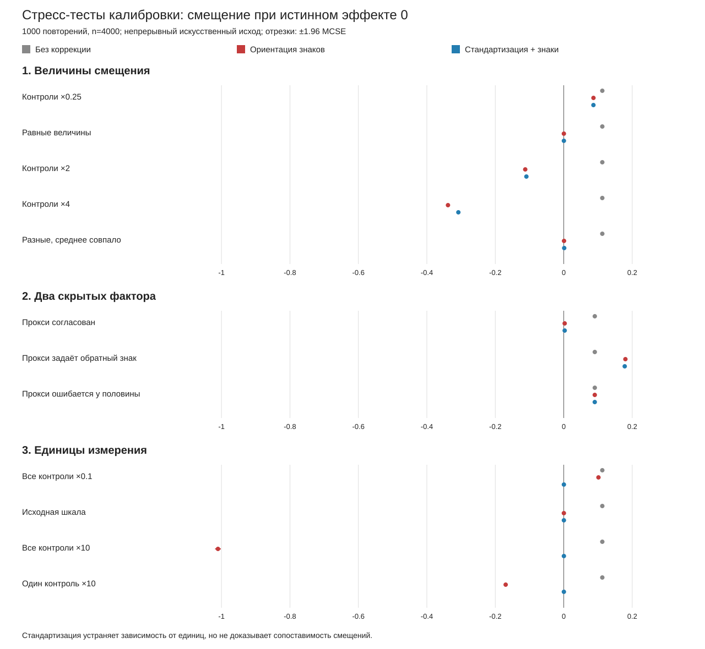

# Результаты проверки устойчивости

29 октября 2026 г. Проверка выполнена на искусственных данных, без OULAD/XES. Рукопись не изменялась.

## Главный результат

Одной ориентации знаков недостаточно для надёжного переноса смещения с контролей на основной исход. Она работает в благоприятной модели с равными модулями смещений, но нарушается при несовпадении средних величин, неполном прокси нескольких конфаундеров и смене единиц измерения контролей. Это поддерживает необходимость переработать центральное методологическое утверждение, а не просто добавить подтверждающую симуляцию.

## Устройство проверки

16 сценариев × 2 истинных эффекта (0 и 0.1) × 1000 повторений; в каждом повторении 4000 наблюдений и 6 отрицательных контролей. Для каждого набора данных сравниваются 6 процедур: всего 192000 записей оценок, 192 сводные строки. Это 32000 наборов данных с общими случайными числами между сценариями, а не 32000 независимых исследований. Генеративная модель и все параметры описаны в README.md и results/config.json.

Оцениватель — разность средних. Проверяется арифметический шаг калибровки из рукописи. Непрерывный Y позволяет точно вычислить истинный эффект и остаточное смещение. Результаты не являются процентными пунктами retention и не заменяют AIPW-проверку на бинарных исходах.

## Основные числа: истинный эффект 0

Покрытие — доля интервалов, включивших истинный эффект; ошибка I рода — доля интервалов, исключивших ноль. «±» у смещения означает одну MCSE, а не стандартное отклонение отдельных оценок.

| Сценарий | Процедура | Смещение ± MCSE | RMSE | Покрытие 95% | Ошибка I рода | Ширина |
|---|---|---:|---:|---:|---:|---:|
| Равные величины | Без коррекции | +0.1126 ± 0.0010 | 0.1172 | 0.058 | 0.942 | 0.124 |
| Равные величины | Знаки | +0.0003 ± 0.0011 | 0.0348 | 0.942 | 0.058 | 0.135 |
| Равные величины | Стандартизация + знаки | +0.0003 ± 0.0011 | 0.0346 | 0.942 | 0.058 | 0.135 |
| Контроли ×2 | Без коррекции | +0.1126 ± 0.0010 | 0.1172 | 0.058 | 0.942 | 0.124 |
| Контроли ×2 | Знаки | -0.1126 ± 0.0011 | 0.1178 | 0.106 | 0.894 | 0.135 |
| Контроли ×2 | Стандартизация + знаки | -0.1092 ± 0.0011 | 0.1145 | 0.123 | 0.877 | 0.134 |
| Контроли ×4 | Без коррекции | +0.1126 ± 0.0010 | 0.1172 | 0.058 | 0.942 | 0.124 |
| Контроли ×4 | Знаки | -0.3383 ± 0.0011 | 0.3401 | 0.000 | 1.000 | 0.133 |
| Контроли ×4 | Стандартизация + знаки | -0.3080 ± 0.0011 | 0.3099 | 0.000 | 1.000 | 0.131 |
| Разные, среднее совпало | Без коррекции | +0.1126 ± 0.0010 | 0.1172 | 0.058 | 0.942 | 0.124 |
| Разные, среднее совпало | Знаки | +0.0008 ± 0.0011 | 0.0347 | 0.999 | 0.001 | 0.285 |
| Разные, среднее совпало | Стандартизация + знаки | +0.0013 ± 0.0011 | 0.0346 | 0.999 | 0.001 | 0.282 |
| Прокси задаёт обратный знак | Без коррекции | +0.0907 ± 0.0011 | 0.0966 | 0.191 | 0.809 | 0.124 |
| Прокси задаёт обратный знак | Знаки | +0.1801 ± 0.0013 | 0.1849 | 0.012 | 0.988 | 0.135 |
| Прокси задаёт обратный знак | Стандартизация + знаки | +0.1781 ± 0.0013 | 0.1829 | 0.013 | 0.987 | 0.135 |
| Прокси ошибается у половины | Без коррекции | +0.0907 ± 0.0011 | 0.0966 | 0.191 | 0.809 | 0.124 |
| Прокси ошибается у половины | Знаки | +0.0906 ± 0.0011 | 0.0975 | 0.990 | 0.010 | 0.407 |
| Прокси ошибается у половины | Стандартизация + знаки | +0.0906 ± 0.0011 | 0.0975 | 0.988 | 0.012 | 0.399 |
| Все контроли ×0.1 | Без коррекции | +0.1126 ± 0.0010 | 0.1172 | 0.058 | 0.942 | 0.124 |
| Все контроли ×0.1 | Знаки | +0.1013 ± 0.0010 | 0.1065 | 0.112 | 0.888 | 0.124 |
| Все контроли ×0.1 | Стандартизация + знаки | +0.0003 ± 0.0011 | 0.0346 | 0.942 | 0.058 | 0.135 |
| Все контроли ×10 | Без коррекции | +0.1126 ± 0.0010 | 0.1172 | 0.058 | 0.942 | 0.124 |
| Все контроли ×10 | Знаки | -1.0103 ± 0.0042 | 1.0191 | 0.000 | 1.000 | 0.399 |
| Все контроли ×10 | Стандартизация + знаки | +0.0003 ± 0.0011 | 0.0346 | 0.942 | 0.058 | 0.135 |
| Один контроль ×10 | Без коррекции | +0.1126 ± 0.0010 | 0.1172 | 0.058 | 0.942 | 0.124 |
| Один контроль ×10 | Знаки | -0.1697 ± 0.0020 | 0.1809 | 0.996 | 0.004 | 1.547 |
| Один контроль ×10 | Стандартизация + знаки | +0.0003 ± 0.0011 | 0.0346 | 0.942 | 0.058 | 0.135 |

## Восстановление ненулевого эффекта 0.1

| Сценарий | Процедура | Средняя оценка | Смещение | Покрытие | Мощность |
|---|---|---:|---:|---:|---:|
| Равные величины | Знаки | +0.1003 | +0.0003 | 0.942 | 0.815 |
| Равные величины | Стандартизация + знаки | +0.0999 | -0.0001 | 0.944 | 0.813 |
| Равные величины | Известный перенос (oracle) | +0.1003 | +0.0003 | 0.948 | 0.828 |
| Контроли ×2 | Знаки | -0.0126 | -0.1126 | 0.106 | 0.076 |
| Контроли ×2 | Стандартизация + знаки | -0.0101 | -0.1101 | 0.116 | 0.067 |
| Контроли ×2 | Известный перенос (oracle) | +0.1000 | +0.0000 | 0.939 | 0.869 |
| Прокси задаёт обратный знак | Знаки | +0.2818 | +0.1818 | 0.002 | 1.000 |
| Прокси задаёт обратный знак | Стандартизация + знаки | +0.2801 | +0.1801 | 0.003 | 1.000 |
| Прокси задаёт обратный знак | Известный перенос (oracle) | +0.0994 | -0.0006 | 0.949 | 0.815 |
| Все контроли ×10 | Знаки | -0.9103 | -1.0103 | 0.000 | 0.990 |
| Все контроли ×10 | Стандартизация + знаки | +0.0999 | -0.0001 | 0.944 | 0.813 |
| Все контроли ×10 | Известный перенос (oracle) | +0.1003 | +0.0003 | 0.948 | 0.828 |

## Интерпретация трёх экспериментов

1. **Величина смещения.** При bY>0 и правильных знаках остаток равен bY−mean(|bk|). Нагрузки могут различаться без смещения, если средняя величина совпадает с целевой; равенство средних — дополнительное условие, которое ориентация не устанавливает. Раздел 3.5 рукописи ошибочно распространяет точное устранение смещения на произвольные bk. Удвоение средней силы контроля оставляет остаток −bY, даже при известном правильном знаке.

2. **Несколько факторов.** В неблагоприятном сценарии модули смещений специально оставлены равными целевому. Контроль имеет нагрузку (−0.1,0.2), а лечение зависит от U1+U2. Прокси U1+noise коррелирует с контролем отрицательно, хотя суммарное смещение положительно. Поэтому сбой вызван именно ориентацией по неполному прокси. Это конструктивный контрпример, а не оценка частоты такого события в образовательных данных.

3. **Единицы.** Умножение всех контролей на 10 изменяет предельную коррекцию в 10 раз, хотя причинное устройство и информация не изменились. Сдвиг на 100 и обращение знаков, напротив, сохраняют результат sign-aware, как и должны. Стандартизация устраняет зависимость от аффинных шкал, но не гарантирует равенства конфаундинга: дисперсия контроля включает специфический шум, а не только общий скрытый фактор.

## Проверки и неопределённость

- Пройдены аналитические проверки равных/неравных нагрузок, смены единиц, обращения знаков и аффинной инвариантности стандартизации.
- Смещения oracle-sign во всех сценариях находятся в пределах 5 MCSE от точных популяционных значений; oracle-transfer — в пределах 5 MCSE от нулевого смещения.
- При истинном эффекте 0 ошибка I рода равна 1−покрытие, поскольку оба события получены из одного двухстороннего интервала.
- При 1000 повторениях MCSE доли около 0.95 равна примерно 0.0069. Малые отклонения от 0.95 не следует объявлять доказательством нарушения покрытия.
- MoM-интервалы — plug-in-формула рукописи: неопределённость ориентации, стандартизации и параметров эмпирического нуля отдельно не распространяется. Поведение этих интервалов не характеризует все существующие методы эмпирической калибровки.

## Что это означает для переработки статьи

Текущая проверка не устанавливает новый метод. Она даёт основание заменить безусловное утверждение о восстановлении смещения на условия переносимости и контрпримеры. Термин «исправление канонической калибровки» требует отдельной проверки по оригинальным публикациям и реализации пакета.

Перспективный следующий этап — обосновать коэффициенты переноса смещения или диапазоны чувствительности к ним. Нельзя оценить bY/bk только по знакам корреляций. Oracle-transfer в таблицах использует истинные параметры генеративной модели; он демонстрирует, какая информация нужна, но не является практически доступным решением.

Для полноценного методологического результата далее нужны: идентификационные предпосылки; корректное распространение неопределённости; бинарные/нелинейные DGP и AIPW; реальные контроли в полусинтетических данных; сопоставление с существующими методами переноса и калибровки. Следует оценивать честные интервалы и устойчивость, а не добиваться желаемой значимости.

## Воспроизводимость

Запуск и протокол: README.md. Полные числа: results/summary.csv. Отдельные повторения: results/replications.csv. Аналитическая истина: results/population_truth.csv. Параметры, версии и SHA-256 исходного расчётного скрипта: results/config.json. Хеши таблиц и длительность: results/manifest.json. Дополнительные проверки: results/analysis_checks.json.
